# LedgerPilot — Autonomous Accounts Payable, Contract Compliance & Wire-Fraud Defense

> **Enterprise-grade FinOps AI control plane** combining pre-LLM PDF forensics & bomb/exploit scanning, multimodal **Gemini 4 Hydrogen (`gemini-4-hydrogen`)** extraction with strict 30s latency guardrails, automatic failover and circuit breakers, deterministic `Decimal` 3-way matching, cross-file duplicate invoice shielding, OFAC sanctions screening, vendor-isolated `pgvector` Contract RAG, PostgreSQL-checkpointed LangGraph HITL approvals with `FOR UPDATE` concurrency locks and SOX 404 Segregation of Duties, HMAC-SHA256 cryptographically sealed audit logs, n8n edge orchestration, a role-scoped MCP v2 server, and self-healing **ISO 20022 (`pain.001.001.03`)** wire settlement.

[](.github/workflows/ci.yml)
[-10B981)](#verification--evaluation-scorecard)
[](evals/results/EVAL_REPORT.md)
[](#architecture)
[](#tech-stack)

---

## Live Deployment & Walkthrough
- **Live Command Center (Vercel):** https://ledgerpilot-delta.vercel.app
- **Live FastAPI Swagger Docs (Render):** https://ledgerpilot-x5pt.onrender.com/docs
- **90-Second Architecture Walkthrough:** [`docs/DEMO_SCRIPT.md`](docs/DEMO_SCRIPT.md)
- **Architecture Decision Record:** [`docs/ADR-001-architecture.md`](docs/ADR-001-architecture.md)

---

## Architecture

```mermaid
flowchart LR
    A[Drag-and-Drop UI / API / Gmail] -->|15 MB Stream Cap + Magic-Byte & Rate-Limit Gate| B[FastAPI Intake + SHA-256 Idempotency]
    A2[n8n Edge Workflows] -->|HMAC-SHA256 + TTL Replay Cache| B
    B --> C[Pre-LLM PDF Forensics + Bomb & Exploit Scanner]
    C --> D[Gemini 4 Hydrogen Extractor + 30s Timeout Failover & Circuit Breaker]
    D --> E[Deterministic Decimal 3-Way Match + Cross-File Duplicate, IBAN & OFAC Guard]
    E --> F[Vendor-Isolated pgvector Hybrid Contract RAG]
    F --> G{Deterministic Policy Engine}
    G -->|Injection / Exploit / Duplicate / IBAN / OFAC| H[QUARANTINED_FRAUD_RISK + Alert]
    G -->|Clean & < $1,000 USD Eq.| I[AUTO_APPROVED]
    G -->|>= $1,000 USD Eq. or Variance| J[LangGraph Postgres Checkpoint Pause]
    J -->|FOR UPDATE Lock + RBAC + FX Spend Cap + SOX 404 SoD| K{Approved?}
    K -->|Yes| L[Self-Healing ISO 20022 pain.001 XML]
    I --> L
    K -->|No| M[REJECTED]
    O[Scoped MCP v2 Server] -->|Role-Scoped HTTP + Consent Gate| B
```



---

## Enterprise Cybersecurity, FinOps & Reliability Invariants

- **Deterministic Policy Over LLM Output:** Financial math (`NUMERIC(14,2)` / Python `Decimal`), cross-file duplicate invoice detection (`DUPLICATE_INVOICE_NUMBER_FRAUD_RISK` blocking altered PDFs reusing an active `(vendor_id, invoice_number)`), master IBAN verification, OFAC/EU sanctions jurisdiction screening (`IR`, `KP`, `SY`, `CU`, `RU`, `BY`), FX-normalized USD spend caps, zero/negative-amount & unsupported-currency escalation, and fraud quarantine execute purely in Python — LLMs cannot approve wires or bypass security holds.
- **Pre-LLM Document, Bomb & Exploit Defense:** Enforces 15 MB chunked streaming reads (anti-OOM DoS), magic-byte & anti-polyglot validation (blocking PE/EXE, ELF, ZIP, SVG/XML, PHP, and HTML/XSS disguises), 40 MP / 10,000 px image decompression-bomb header checks, path-traversal sanitization, encrypted PDF container rejection, structural PDF bomb limits (`50` pages / `10,000` xref objects), PyMuPDF xref scanning for weaponized active content (`/JavaScript`, `/Launch`, `/OpenAction`, `/EmbeddedFile`, `/SubmitForm`, `/ImportData`, `/GoToR`, `/GoToE`, `/XFA`), plus white-on-white hidden text, micro-font, off-page `INFINITE_RECT`, metadata, annotation, and zero-width Unicode detection.
- **SOX 404 Governance, RBAC & Concurrency Safety:** Enforces backend role hierarchy (`AP_CLERK` → `FINANCE_MANAGER` → `CONTROLLER` → `ADMIN`), FX-normalized per-role USD spend caps, Segregation of Duties (blocks uploader self-approval), PostgreSQL `FOR UPDATE` row-level locking (prevents double-approval race conditions), automatic approval state rollback if checkpoint resumption fails, and Platform Admin–only archive/delete that preserves immutable HMAC audit logs while releasing SHA-256 deduplication locks.
- **Dual-Layer Tamper-Proof Audit Ledger:** Combines a PostgreSQL `BEFORE UPDATE OR DELETE` append-only trigger with per-row **HMAC-SHA256 cryptographic seals** verifiable live via `GET /api/v1/security/audit-integrity`.
- **Zero-Leakage Multi-Tenant Contract RAG:** `pgvector` HNSW cosine similarity (85%) + lexical overlap (15%) is strictly isolated by `WHERE vendor_id = :id`, escalates below `0.45` evidence similarity, and strips unverified LLM citations in Python.
- **Production API & Network Hardening:** Shared HTTP/2 **Gemini 4 Hydrogen** client with 30s per-call timeouts, low-latency thinking control, and multi-model failover (`gemini-4-hydrogen` → `gemini-3.8-flash` → `gemini-3.5-flash-lite`); `CLOSED → OPEN → HALF_OPEN` circuit breakers; daily FinOps LLM spend ceiling; intra-window TTL webhook replay cache (`2 MB` body cap + constant-time `hmac.compare_digest`); sliding-window rate limiting across all AI and workflow endpoints (`/ingest`, `/process`, `/retry`, `/decide`, `/demo/run`, `/contracts/search`, `/webhooks`); allowlisted CORS & `X-Correlation-ID` sanitization; redacted production `500` responses; strict HTTP security headers (`HSTS`, `CSP`, `X-Frame-Options: DENY`, `Cache-Control: no-store`); crash-recovery `FAILED` state persistence; and ephemeral-disk-proof ISO 20022 XML reconstruction from PostgreSQL.

---

## Verified End-to-End Global Scenarios (Gemini 4 Hydrogen)

| Scenario & Invoice | Region / Amount | Live Outcome | Latency / LLM Cost | Controls Demonstrated |
| :--- | :--- | :--- | :---: | :--- |
| **1. Clean Auto-Settlement**<br>`INV-APEX-2026-1001` | US · `USD 850.00` | `PAYMENT_STAGED` | `18.5 s` · `$0.0103` | `0/100` forensics, 4/4 3-way match `PASS`, MSA §4.1 & §4.3 cited, bank-ready `USD` ISO 20022 XML staged |
| **2. Cross-Border EU VAT**<br>`INV-RPS-2026-4001` | Germany · `EUR 3,200.00` | `AWAITING_APPROVAL` | `9.2 s` · `$0.0094` | 0% EU reverse-charge VAT (`MSA §2.3`, 78.9% sim.), FX-normalized HITL pause for Finance Manager, `EUR` wire on resume |
| **3. 3-Way GR Variance**<br>`INV-ALNOOR-2026-3001` | UAE · `USD 6,000.00` | `AWAITING_APPROVAL` | `17.1 s` · `$0.0052` | Caught `QTY_EXCEEDS_GOODS_RECEIPT` (10 pallets billed vs. 7 received on `GR-2026-3001`) + `MSA §6.1` violation hold |
| **4. OWASP BEC Wire Fraud**<br>`INV-BEC-2026-9001` | Red-Team · `USD 850.00` | `QUARANTINED_FRAUD_RISK` | `11.1 s` · `$0.0119` | `100/100` risk; caught white-text `SYSTEM OVERRIDE` prompt injection, hijacked Cyprus IBAN, and unit-price overcharge; 0% wire leakage |
| **5. UK VAT Controller Gate**<br>`INV-TCA-2026-2001` | UK · `GBP 17,400.00` | `AWAITING_APPROVAL` | `12.1 s` · `$0.0112` | Multi-line subtotal (`GBP 14,500`) + itemized 20% UK VAT (`GBP 2,900`, `MSA §3.2`); blocks `$10k` Manager (`403`), escalates to Controller |

---

## Interactive FinOps Command Center (4 Workspaces)

1. **Command:** Live compliance telemetry dial, FX-normalized USD treasury KPIs, drag-and-drop Invoice Ingestion Vault, synced 5-stage LangGraph pipeline visualizer with 100% completion sweep, Sandbox Simulator drawer, `Ctrl+K` Command Palette, and dual light/dark themes.
2. **Ledger:** `0ms` in-memory cached dossier switching with background & hover prefetching, OWASP forensic findings, deterministic 3-way match pills, `pgvector` MSA clause citations, 1-click ISO 20022 XML copy/download, self-healing workflow retry, Manual Fraud Hold modal, and Platform Admin SOX 404 Delete.
3. **Approvals:** Live RBAC persona switcher (**Maya Patel** / **James Holloway** / **Elena Rostova** / **Amaan Shaikh**) to test live backend `403` RBAC, FX spend-cap, and SOX 404 Segregation of Duties guards alongside durable LangGraph checkpoint resumes and SLA breach escalations.
4. **Intelligence:** Verified international vendor master registry, live `pgvector` semantic MSA contract query playground, Security Posture & circuit-breaker telemetry, 1-click **Verify Cryptographic Audit Chain** check, 100-case eval breakdown, and Controller/Admin-gated Dead-Letter Queue triage.

> **Sandbox Authentication Note:** The hosted showcase exposes a persona switcher backed by sandbox API keys so reviewers can test RBAC, FX spend-cap, and SOX 404 enforcement immediately. In enterprise production deployments, API keys are replaced by OIDC/JWT identity tokens (Microsoft Entra ID / Okta).

---

## Verification & Evaluation Scorecard

Automated verification across **100 labeled enterprise invoice PDFs** (8 operational and adversarial categories) plus **42 automated tests** (17 unit/integration + 15 OWASP LLM01 red-team + 10 enterprise cybersecurity & reliability tests):

| Gate | Measured Result | Release Threshold | Status |
| :--- | ---: | ---: | :---: |
| 100-Case Routing & Policy Accuracy | **100.00%** (100 / 100) | >= 99.00% | PASS |
| Wire-Fraud & Prompt-Injection Recall | **100.00%** (25 / 25) | 100.00% | PASS |
| False-Positive Quarantine Rate (Branded PDFs) | **0.00%** (0 / 75) | 0.00% | PASS |
| Automated Test Suite (`pytest`) | **42 / 42 Passing** | 100% | PASS |
| Deterministic Gate Latency (`p50` / `p95`) | **5.14 ms / 5.93 ms** | < 100 ms | PASS |
| Live End-to-End Latency (Gemini 4 Hydrogen) | **9.2 s – 18.5 s / PDF** | < 120 s | PASS |
| Operating Cost per Invoice (Gemini 4 Hydrogen) | **~\$0.005 – \$0.012 / PDF** | < \$0.02 | PASS |

Full benchmark breakdown: [`evals/results/EVAL_REPORT.md`](evals/results/EVAL_REPORT.md)

---

## Tech Stack
- **Backend & AI:** Python 3.12, FastAPI, SQLAlchemy 2.0 (async), Alembic, LangGraph (`langgraph-checkpoint-postgres`), Google GenAI SDK (`gemini-4-hydrogen` + multi-model failover + circuit breakers), PyMuPDF (`pymupdf`), ReportLab, Tenacity, Ruff, Pytest.
- **Database & Vector Store:** PostgreSQL 16 + `pgvector` (768-dim L2-normalized HNSW index) hosted on Neon.
- **Edge Orchestration & Tooling:** Self-hosted n8n (3 exportable blueprints in `n8n/workflows/`), Official MCP SDK v2 (`mcp_server/server.py`).
- **Frontend:** Next.js (App Router), TypeScript, Tailwind CSS, Framer Motion, Lucide Icons hosted on Vercel.

---

## Quickstart (Local Docker)

```bash
# 1. Start PostgreSQL (pgvector) + n8n
cp .env.example .env   # add your GEMINI_API_KEY
docker compose up -d

# 2. Migrate DB, seed enterprise fixtures & index MSA embeddings
cd backend
uv sync --frozen
uv run alembic upgrade head
uv run python -m app.db.seed
uv run python -m app.services.rag

# 3. Verify all 42 tests + 100-case eval gate
uv run pytest -v
uv run python ../evals/run_eval.py

# 4. Run Backend API (:8000) & Next.js Command Center (:3000)
uv run uvicorn app.main:app --reload --port 8000
# In a second terminal:
cd ../frontend && npm install && npm run dev
```

Open **`http://localhost:3000`** for the Live Command Center, **`http://localhost:8000/docs`** for OpenAPI Swagger docs, and **`http://localhost:5678`** for n8n.