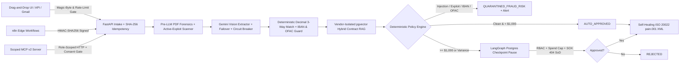

# LedgerPilot — Autonomous Accounts Payable, Contract Compliance & Wire-Fraud Defense

> **MNC-grade FinOps AI automation control plane** combining pre-LLM PDF forensics & active-exploit scanning, multimodal Gemini extraction with automatic failover and circuit breakers, deterministic `Decimal` 3-way matching, OFAC sanctions screening, vendor-isolated `pgvector` Contract RAG, PostgreSQL-checkpointed LangGraph HITL approvals with SOX 404 Segregation of Duties, HMAC-SHA256 cryptographically sealed audit logs, n8n edge orchestration, a role-scoped MCP v2 server, and self-healing **ISO 20022 (`pain.001.001.03`)** wire settlement.

[](.github/workflows/ci.yml)
[-10B981)](#verification--evaluation-scorecard)
[](evals/results/EVAL_REPORT.md)
[](#architecture)

---

## Live Deployment
- **Live Command Center (Vercel):** https://ledgerpilot-delta.vercel.app
- **Live FastAPI Swagger Docs (Render):** https://ledgerpilot-x5pt.onrender.com/docs

---

## Live Links
* **Live Command Center (Vercel):** _Add your Vercel URL after cloud deployment_
* **Live API Swagger Docs (Render):** _Add your Render URL `/docs` after cloud deployment_
* **90-Second Architecture Walkthrough:** [`docs/DEMO_SCRIPT.md`](docs/DEMO_SCRIPT.md)
* **Architecture Decision Record:** [`docs/ADR-001-architecture.md`](docs/ADR-001-architecture.md)

---

## Architecture



### MNC Cybersecurity & Reliability Invariants
* **Deterministic Policy Over LLM Output:** Financial math (`NUMERIC(14,2)` / Python `Decimal`), IBAN verification, OFAC sanctions screening (`IR`, `KP`, `SY`, `CU`, `RU`, `BY`), spend caps, and fraud quarantine execute purely in Python—LLMs cannot approve wires or bypass security holds.
* **Pre-LLM Document & Exploit Defense:** Enforces magic-byte and anti-polyglot upload validation (blocking PE/EXE, ELF, ZIP, and HTML/XSS disguises), path-traversal sanitization, PyMuPDF xref scanning for weaponized PDF actions (`/JavaScript`, `/Launch`, `/OpenAction`, `/EmbeddedFile`), plus banner-aware white-on-white text, micro-font, off-page `INFINITE_RECT`, metadata, annotation, and zero-width Unicode detection.
* **SOX 404 Segregation of Duties & RBAC:** Enforces backend role hierarchy (`AP_CLERK` → `FINANCE_MANAGER` → `CONTROLLER` → `ADMIN`), per-role approval spend limits, and blocks any user from self-approving an invoice they uploaded.
* **Dual-Layer Tamper-Proof Audit Ledger:** Combines a PostgreSQL `BEFORE UPDATE OR DELETE` append-only trigger with per-row **HMAC-SHA256 cryptographic seals** verifiable live via `GET /api/v1/security/audit-integrity`.
* **Zero-Leakage Multi-Tenant RAG:** `pgvector` HNSW cosine similarity (85%) + lexical overlap (15%) is strictly scoped by `WHERE vendor_id = :id`, escalates below `0.45` evidence similarity, and strips unverified LLM citations in Python.
* **Production Resilience:** Thread-safe `CLOSED → OPEN → HALF_OPEN` circuit breakers on Gemini and n8n, a daily FinOps LLM spend ceiling, sliding-window rate limiting with strict HTTP security headers (`HSTS`, `CSP`, `X-Frame-Options: DENY`, `Cache-Control: no-store`), auditable Dead-Letter Queue resolution, and ephemeral-disk-proof ISO 20022 XML reconstruction from PostgreSQL.

---

## Interactive FinOps Command Center (4 Operational Views)
1. **Invoice Ledger & Audit Dossier:** Drag-and-drop invoice upload, 4 live 1-click end-to-end scenarios, real-time LangGraph pipeline stage telemetry, search/status filters, one-click ISO 20022 XML copy/download, self-healing workflow retry, and RBAC-guarded Manual Fraud Hold modal.
2. **HITL Approval Queue:** Live persona switcher (Maya Patel / James Holloway / Elena Rostova / Amaan Shaikh) to test backend `403` RBAC and SOX 404 blocks vs. durable LangGraph checkpoint resumes and SLA breach escalations.
3. **Vendors & MSA RAG Explorer:** Verified international vendor bank master registry and a live `pgvector` semantic contract query playground with animated similarity meters.
4. **Security, Analytics & DLQ:** Live MNC Security Posture telemetry, upstream circuit-breaker states, daily LLM spend meter, 1-click **Verify Cryptographic Audit Chain** button, animated SVG outcome mix chart, 100-case eval breakdown, and Controller/Admin-gated Dead-Letter Queue triage.

> **Sandbox Authentication Note:** The hosted demo exposes a persona switcher backed by sandbox API keys so reviewers can test RBAC, spend-cap, and SOX 404 enforcement in seconds. In MNC production deployments, API keys are replaced by OIDC/JWT identity tokens (Microsoft Entra ID / Okta).

---

## Verification & Evaluation Scorecard

Automated verification across **100 labeled enterprise invoice PDFs** (8 operational and adversarial categories) plus **42 automated tests** (17 unit/integration + 15 OWASP LLM01 red-team + 10 MNC cybersecurity & reliability tests):

| Gate | Measured Result | Release Threshold | Status |
| :--- | ---: | ---: | :---: |
| 100-Case Routing & Policy Accuracy | **100.00%** (100 / 100) | >= 99.00% | PASS |
| Wire-Fraud & Prompt-Injection Recall | **100.00%** (25 / 25) | 100.00% | PASS |
| False-Positive Quarantine Rate (Branded PDFs) | **0.00%** (0 / 75) | 0.00% | PASS |
| Automated Test Suite (`pytest`) | **42 / 42 Passing** | 100% | PASS |
| Deterministic Gate Latency (`p50` / `p95`) | **5.14 ms / 5.93 ms** | < 100 ms | PASS |
| Operating Cost per Invoice (Gemini Flash) | **~\$0.0016 / PDF** | < \$0.01 | PASS |

Full benchmark breakdown: [`evals/results/EVAL_REPORT.md`](evals/results/EVAL_REPORT.md)

---

## Tech Stack
* **Backend & AI:** Python 3.12, FastAPI, SQLAlchemy 2.0 (async), Alembic, LangGraph (`langgraph-checkpoint-postgres`), Google GenAI SDK (multi-model failover + circuit breakers), PyMuPDF (`pymupdf`), ReportLab, Tenacity, Ruff, Pytest.
* **Database & Vector Store:** PostgreSQL 16 + `pgvector` (768-dim L2-normalized HNSW index).
* **Edge Orchestration & Tooling:** Self-hosted n8n (3 exportable blueprints in `n8n/workflows/`), Official MCP SDK v2 (`mcp_server/server.py`).
* **Frontend:** Next.js (App Router), TypeScript, Tailwind CSS, Framer Motion, Lucide Icons.

---

## Quickstart (Local Docker)

```bash
# 1. Start PostgreSQL (pgvector) + n8n
cp .env.example .env   # add your GEMINI_API_KEY
docker compose up -d

# 2. Migrate DB, seed enterprise fixtures & index MSA embeddings
cd backend
uv sync --frozen
uv run alembic upgrade head
uv run python -m app.db.seed
uv run python -m app.services.rag

# 3. Verify all 42 tests + 100-case eval gate
uv run pytest -v
uv run python ../evals/run_eval.py

# 4. Run Backend API (:8000) & Next.js Command Center (:3000)
uv run uvicorn app.main:app --reload --port 8000
# In a second terminal:
cd ../frontend && npm install && npm run dev
```

Open **`http://localhost:3000`** for the Live Command Center, **`http://localhost:8000/docs`** for OpenAPI Swagger docs, and **`http://localhost:5678`** for n8n.
